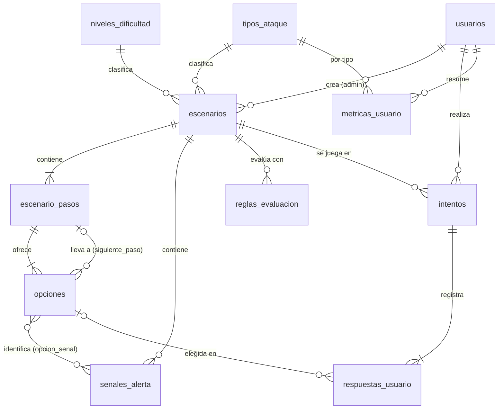

# Modelo de datos

Esquema completo en [backend/db/migrations/001_esquema_inicial.sql](../backend/db/migrations/001_esquema_inicial.sql).

## Cambios respecto a la propuesta inicial

| Cambio | Motivo |
|---|---|
| Tabla `escenario_pasos` y `opciones.siguiente_paso_id` | Permite escenarios con varias decisiones encadenadas y ramificadas. Si `siguiente_paso_id` es NULL, el escenario termina. |
| Catálogos `tipos_ataque` y `niveles_dificultad` | Evitan valores inconsistentes y comparten llave foránea entre `escenarios` y `metricas_usuario`. `niveles_dificultad.valor` es ordinal, útil para ML. |
| `senales_alerta` + `opcion_senal` (N:M) | Registra qué señales contiene el escenario y cuáles identificó el usuario según sus decisiones. |
| Reglas estructuradas (`tipo_regla` + `parametros` JSONB) | Una condición en texto libre no se puede evaluar de forma segura. Los tipos son: `OPCION_SELECCIONADA`, `TIPO_ACCION_PRESENTE`, `CONTEO_TIPO_ACCION`, `SECUENCIA`. Si `escenario_id` es NULL, la regla es global. |
| `rangos_vulnerabilidad` versionada | Los umbrales se modifican sin cambiar código; cada intento guarda la versión con la que se evaluó. |
| `respuestas_usuario` guarda una copia de texto, tipo de acción y puntuación | Editar un escenario no altera el historial ni los datos para ML. |
| `respuestas_usuario.tiempo_respuesta_ms`, `intentos.numero_intento`, `duracion_ms` | Variables candidatas para el futuro modelo de clasificación. |
| `intentos.estado`, `paso_actual_id`, `resultado` JSONB | Controlan la ejecución paso a paso y conservan la retroalimentación calculada. |
| `metricas_usuario` con `UNIQUE (usuario_id, tipo_ataque_id)` | Tabla de resumen que se actualiza en la misma transacción que finaliza el intento. |
| `usuarios.rol` | Separa usuarios generales de administradores (CRUD de escenarios). |
| `escenarios.codigo` (PH-001) y `estado` con `eliminado` | Identificador legible y eliminación lógica que conserva el historial. |
| Claves estables (`clave`) en pasos, opciones y señales | El escenario se describe como un documento JSON que se referencia por clave, no por id. Se usa en el CRUD y en los seeds. |

## Integridad que valida la API

Algunas reglas del grafo no se pueden expresar con restricciones SQL. Las valida [scenarios.structure.js](../backend/src/modules/scenarios/scenarios.structure.js):

- hay exactamente un paso inicial;
- todas las referencias (siguiente paso, señales, opciones en reglas) existen;
- no hay ciclos, así que todo recorrido termina;
- todos los pasos son alcanzables desde el inicial;
- cada paso tiene al menos 2 opciones y las claves de las opciones son únicas en el escenario.

## Seguridad en Supabase

Todas las tablas tienen RLS habilitado **sin políticas**, así que los roles `anon` y `authenticated` de la Data API de Supabase no tienen acceso. La API se conecta con el rol propietario.
